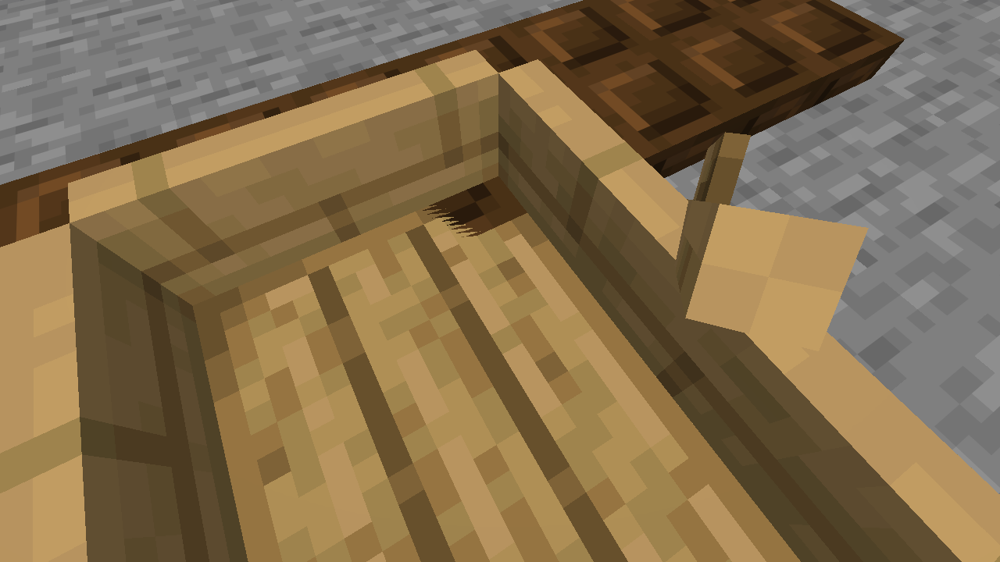

# #5950 — unfinished investigation and partial parity corrections

**Not fixed. The trapdoor still shows through the boat at some viewing angles.**
This work was stopped at the contributor's request and is being handed over. It must not
be treated as a completed fix or used to close #5950. Base: `ac2f22371`.

## Changes preserved

- Both `ModelPart` drawing paths now retain the rounded quaternion length, as JOML does,
  instead of using a matrix formula that assumes an exactly unit quaternion. Positions
  also follow JOML's translation, affine rotation and vertex addition order. Normals and
  positions share the rotation calculation.
- `Camera.getViewRotationMatrix` now uses the existing JOML-compatible matrix arithmetic.
- Boat Y-axis rotations use the existing JOML axis implementation, including its exact
  right-angle cosine.
- The actual world renderer now calls `camera::perspective`, which was already checked
  against vanilla. Previously `gfx::world_projection` used a different implementation.
- A new `boat_floor` differential harness compares both drawing paths with the real
  vanilla boat floor. The camera harness now includes the view matrix and actual renderer
  projection, rather than testing only the camera helper.

There is no boat position offset or depth bias in these changes. These are partial
arithmetic/parity corrections, **not proof that #5950 is solved**.

## Reproduction used

Use an isolated creative world and the normal integrated server, not the deprecated
in-frame path. The successful scene has:

1. A stone platform: `fill -5 100 -5 5 100 8 stone`.
2. Air above it and a row of closed bottom dark-oak trapdoors at `-2 101 2` through `2 101 2`.
3. An oak boat summoned at `0.5 101 0.5`, yaw 0, with the player mounted.
4. Forward input until blocked. The boat stops at `[0.5, 101, 1.3125]`.
5. Release input. Look at yaw 30 / pitch 60, then -30 and +/-45 / pitch 60, without steering the boat.

The player's eye is `[0.5, 102.20750000476838, 1.3125]`. The floor top and trapdoor top
are both at Y `101.1875`. Straight-ahead screenshots can look correct while oblique
ones show the fault. Wait for destination chunks to load before using `/fill`;
the command can return a chat error even when the control transport replies `ok`.

## Verified vanilla references

Pinned 26.3 client bytecode and the player's prepared resources were inspected locally:
`AbstractBoatRenderer.submit`, `BoatModel.createBoatModel`, `ModelPart.translateAndRotate`,
`ModelPart.Cube.compile`, `Camera.getViewRotationMatrix`, `MainTarget`, and the default
depth state. Vanilla also uses **D32_FLOAT, reversed depth, GREATER_THAN_OR_EQUAL and
zero default depth bias**. A standard-Z/24-bit explanation would be incorrect here.

## Validation and limits

- `boat_floor`: 36 root transforms, 1,728 vertices across both drawing paths match vanilla
  positions exactly, including after the boat root rotation change.
- Entity-model parity: 2,101 cases / 49 layers pass after the position arithmetic change.
- Final camera parity: 18,646 cases / 188,413 output lines pass, including the view matrix
  and the actual renderer projection (`renderer_projection`).
- Targeted model lighting tests: 5 passed after the position arithmetic change.
- Clippy passed after that change. Subsequent camera/root/projection changes were built,
  but the complete final-head self-check has not been run.
- An **earlier working tree**, before the later refinements, passed `pr_ready.py --quick`:
  594 Python tests, 1,273 client-library tests, formatting, Clippy and public-tree checks.
  That result must not be represented as a final-head green gate.

## Leads for the next contributor — not established causes

- Vanilla's entity and terrain vertex shaders compose projection and model-view matrices
  on the GPU; Horizon precombines `view_proj` on the CPU. Compare the resulting clip/depth
  values for the coplanar faces before introducing any compensating offset.
- Vanilla terrain forms camera-relative positions using integer `CameraBlockPos` and a
  separate `CameraOffset`; inspect Horizon's section-origin rounding at different positions.
- Vanilla's sequential quad index generator emits `0,1,2,2,3,0`, while Horizon's shared
  index buffer emits `0,1,2,0,2,3`. Check whether this affects raster/depth rounding.
- Compare the exact oblique-view scene with a real vanilla rendering baseline as well as
  the numeric oracles. Passing the numeric tests alone did not eliminate the visual bug.

No game jars, prepared resources, decompiled sources, player saves or credentials are
included. No other project's implementation source was read or copied for this work.
